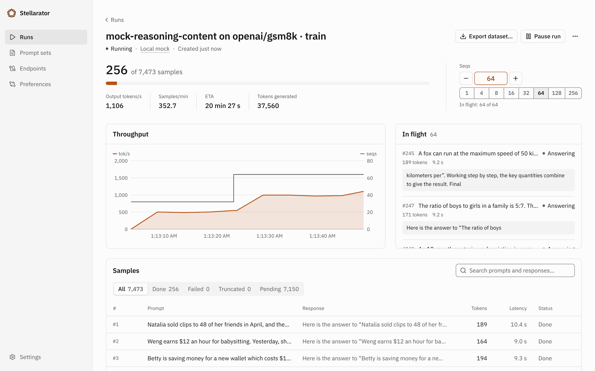
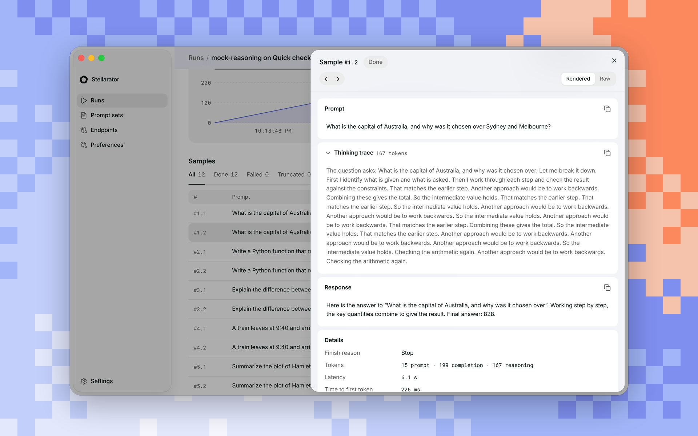
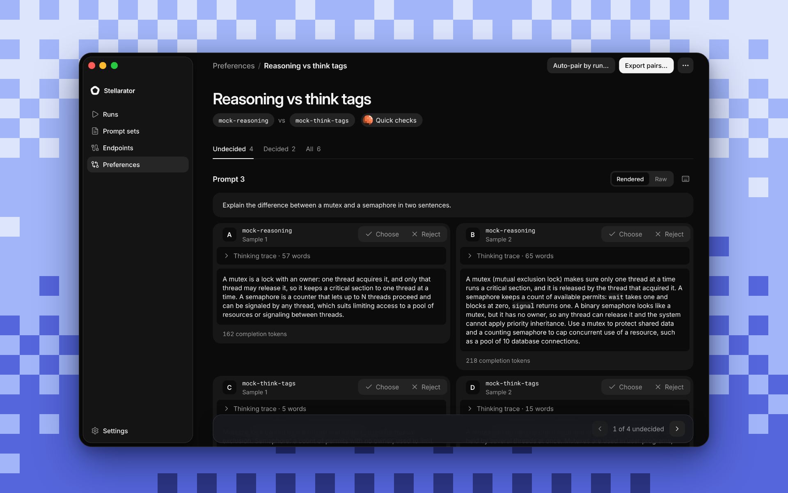
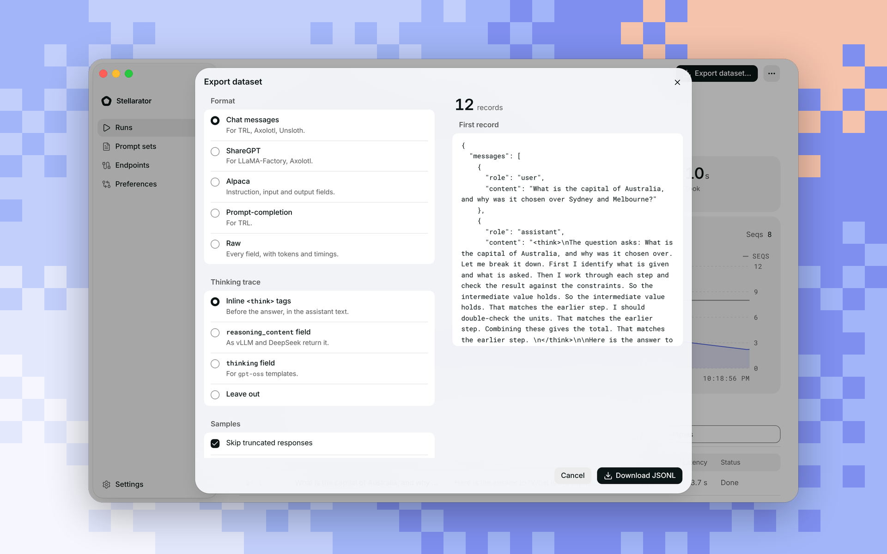

<div align="center">


# Stellarator

**Distillation and preference data from any OpenAI-compatible model.**

Runs your prompts through a model, keeps each prompt with its thinking trace and answer, and
exports the result as a training dataset. A desktop app for macOS, Windows and Linux, or one Docker
container next to your GPU.

[](https://github.com/thekozugroup/Stellarator/actions/workflows/ci.yml)
[](https://github.com/thekozugroup/Stellarator/actions/workflows/desktop.yml)
[](https://github.com/thekozugroup/Stellarator/releases/latest)
[](LICENSE)

[Quick start](#quick-start) · [What it looks like](#what-it-looks-like) ·
[What it does](#what-it-does) · [Export formats](#export-formats) ·
[Desktop app](docs/desktop.md) · [Docker](docs/docker.md) · [Design](DESIGN.md)

</div>

---

## Why

Distilling a model, or collecting preference data, takes the same plumbing every time: send
thousands of requests to an endpoint at a chosen concurrency, retry the ones that fail, find the
thinking trace in whichever field this server puts it, and write the results in the shape a trainer
reads. Done with a script, a run that fails halfway often goes unnoticed until the dataset comes up
short.

Stellarator does that work and shows it while it happens. It does not train models and does not
serve them: it talks to the server you already have, whether that is vLLM on a DGX Spark, LM Studio
on the same Mac, or a hosted API.

## Quick start

**On a Mac, Windows or Linux computer**, download the app from the
[latest release](https://github.com/thekozugroup/Stellarator/releases/latest):

| Computer | File |
| --- | --- |
| Mac with Apple Silicon (M1 or later) | `Stellarator_<version>_aarch64.dmg` |
| Mac with Intel | `Stellarator_<version>_x64.dmg` |
| Windows 10 or 11 | `Stellarator_<version>_x64-setup.exe` (or the `.msi`) |
| Linux (Ubuntu 22.04+, Debian 12+) | `Stellarator_<version>_amd64.AppImage` or `.deb` |

On a Mac, open the `.dmg` and drag Stellarator to Applications. The app is not notarized yet, so
macOS blocks the first open; run this once:

```bash
xattr -dr com.apple.quarantine /Applications/Stellarator.app
```

Or open the app once, then click Open Anyway in System Settings > Privacy & Security. On Windows,
SmartScreen asks too: More info, then Run anyway.

<details>
<summary>Or run it in Docker, on the GPU server itself (a DGX Spark, for example)</summary>

```bash
git clone https://github.com/thekozugroup/Stellarator.git
cd Stellarator
docker compose up -d --build
```

Open `http://<server>:8080` from any browser on your network, phones included. A model server on
the same machine is at `http://host.docker.internal:<port>/v1`. Data is kept in the
`stellarator-data` volume. The image is about 170 MB; [docs/docker.md](docs/docker.md) has the DGX
Spark notes and network options.

To try it without a GPU, start the bundled mock server as well and add an endpoint with base URL
`http://mock:9100/v1`:

```bash
docker compose --profile mock up -d --build
```

</details>

Either way it is one process, the server with its web UI, and one data folder.

> **There is no sign-in.** Anyone who can reach the port can use Stellarator and the API keys saved
> in it, which are stored unencrypted in the data folder. Run it on a trusted network and do not
> expose it to the internet. The desktop app listens on `127.0.0.1` and answers only its own window.

## What it looks like



A run on the 7,473 prompts of `openai/gsm8k`. Seqs went from 32 to 64 partway through, and the
chart shows throughput following. Every sequence in flight is marked thinking or answering.



One sample: the prompt, the thinking trace kept apart from the answer, and the answer rendered as
Markdown with tables, code and LaTeX. Raw shows the text exactly as the model returned it.



Preference review. Two models answer the same prompt; Choose and Reject (or the number keys) make
the pair.



Export. Pick a format and where the thinking trace goes, and the first record is shown exactly as
it will be written.

The screenshots use sample data: the bundled mock server and a small set of prepared answers.

## What it does

### Any OpenAI-compatible server

Anything that serves `/v1/chat/completions` works. Stellarator lists the models it offers and
checks that the API key is accepted. Presets fill in the address and a starting number of seqs:

| Preset | Base URL | Seqs |
| --- | --- | ---: |
| OpenRouter | `https://openrouter.ai/api/v1` (needs a key) | 8 |
| LM Studio | `http://localhost:1234/v1` | 4 |
| Ollama | `http://localhost:11434/v1` | 4 |
| vLLM | `http://localhost:8000/v1` | 64 |
| SGLang | `http://localhost:30000/v1` | 64 |
| llama.cpp server | `http://localhost:8080/v1` | 4 |

In Docker, the local presets use `host.docker.internal` instead of `localhost`.

### Prompts from anywhere, and only the prompts

- **Hugging Face datasets**, one split or all of them, any size. Only the columns that are needed
  are downloaded, and imports run in the background with progress.
- **Files**: Markdown, plain text, CSV, TSV, JSON, JSONL and Parquet, or pasted text. Text is split
  into prompts by separator lines, headings, list items, blank lines or lines. A million rows from
  a Parquet or CSV file import in about 3 seconds.
- **Prompts only.** Taking prompts from someone else's distilled dataset keeps the prompts and
  leaves their model's answers out: `response`, `completion`, `generation`, `reasoning`, `chosen`
  and `rejected` columns are never used as the prompt, and assistant turns in conversations are
  dropped. Choose the conversation up to the last user turn, or the first user turn only. Reference
  answers (`answer`, `solution`, `label`) are kept as metadata for checking later.

The import preview shows the first prompts and what was left out before anything is saved.

### Runs you can leave running

- **Seqs** (sequences in flight) can be changed while the run is going, and the throughput chart
  plots tokens per second against seqs so you can see the effect.
- Failed requests are retried with backoff. After repeated failures in a row the run pauses itself
  instead of working through the rest of the prompt set.
- Pause, resume and retry failed samples. A run interrupted by a restart is paused and resumes
  where it stopped.
- Samples per prompt, temperature, top-p, max tokens, seed, a system prompt, a user template and
  any extra request body (for example `{"chat_template_kwargs": {"enable_thinking": true}}`).

### Thinking traces wherever the server puts them

- `reasoning_content` (vLLM before 0.10, SGLang with a reasoning parser, the DeepSeek API)
- `reasoning` (vLLM 0.10 and later, OpenRouter, Ollama)
- inline `<think>…</think>` tags, including when the chat template opened the tag and the output
  only contains `</think>` (the tags are configurable per run)
- gpt-oss harmony channels, if they leak into the content

For vLLM or SGLang, start the server with a reasoning parser (`--reasoning-parser qwen3` or
`deepseek_r1`, for example) to get the trace as its own field.

### Preference pairs

Collect several candidates per prompt (set samples per prompt to 2 or more, or run the same prompt
set against several models), then make a preference set from those runs. For each prompt, mark one
candidate chosen and one rejected: keys 1 to 9 choose, Shift+1 to 9 reject, J and K move. To pair
two runs wholesale, Auto-pair by run takes the first run's answer as chosen and the second's as
rejected for every prompt.

### Small enough to run next to the model

The server is Rust. Measured on Linux (release build): about 13 MB idle and 32 MB at peak during a
run with 256 sequences in flight; a 100,000-sample run at 512 seqs holds at about 46 MB. The
desktop window is the system's webview, which uses memory of its own; see
[docs/desktop.md](docs/desktop.md#memory). Runs keep going with the window hidden.

## Export formats

Supervised fine-tuning (one record per sample):

| Format | Shape | Used by |
| --- | --- | --- |
| Chat messages | `{"messages": [...]}` | TRL SFTTrainer, Axolotl, Unsloth, most trainers |
| ShareGPT | `{"conversations": [{"from", "value"}]}` | LLaMA-Factory, Axolotl |
| Alpaca | `{"instruction", "input", "output"}` | LLaMA-Factory, older trainers |
| Prompt-completion | `{"prompt": [...], "completion": [...]}` | TRL |
| Raw | prompt, thinking, response, finish reason, usage, latency, parameters | your own pipeline |

Preference (one record per pair):

| Format | Shape | Used by |
| --- | --- | --- |
| DPO | `{"prompt", "chosen", "rejected"}` | TRL DPO, ORPO, CPO, SimPO |
| KTO | `{"prompt", "completion", "label"}` | TRL KTO |

The thinking trace can go inline as `<think>` tags, in a `reasoning_content` field (Qwen3 and
DeepSeek chat templates), in a `thinking` field (gpt-oss chat template), or be left out. Files are
JSONL, JSON, Parquet or CSV, downloaded or pushed straight to the Hugging Face Hub. Truncated
responses (finish reason `length`) are skipped by default.

## Configuration

Everything else is set in the app. These environment variables are read at start:

| Variable | Default | Notes |
| --- | --- | --- |
| `STELLARATOR_DATA_DIR` | `./data` | Database, uploads and temporary export files. `/data` in Docker; the app's data folder on the desktop |
| `STELLARATOR_BIND` | `0.0.0.0:8080` | Server and Docker: the address to listen on |
| `STELLARATOR_PORT` | `8080` | Docker Compose: the host port |
| `HF_TOKEN` | none | Hugging Face token for gated datasets and Hub pushes; wins over the one saved in Settings |
| `STELLARATOR_DESKTOP_PORT` | `47823` | Desktop app: the local port to try first |
| `RUST_LOG` | `info` | Log detail, for example `debug` |

The desktop app's data lives in `~/Library/Application Support/com.thekozugroup.stellarator` on a
Mac; [docs/desktop.md](docs/desktop.md) lists the folders for Windows and Linux.

## Development

The web UI is built first, because the server embeds it:

```bash
cd frontend && npm ci && npm run build && cd ..
cargo run -p stellarator-server        # http://localhost:8080, data in ./data
cargo run -p stellarator-mock -- --port 9100
```

For frontend work, `npm run dev` in `frontend/` proxies `/api` to port 8080. The desktop app is in
`desktop/` (Tauri 2); building it is described in [docs/desktop.md](docs/desktop.md).

Tests:

```bash
cargo test --workspace
(cd frontend && npm test)
```

The black-box API suite in [`tests/contract`](tests/contract) starts its own server and mock:

```bash
cargo build -p stellarator-server -p stellarator-mock
STELLARATOR_START=rust uv run --project tests/contract pytest tests/contract -m "not v1"
```

To release, set the same version in `Cargo.toml`, `desktop/src-tauri/Cargo.toml` and
`desktop/package.json` and push to `main`: the installers are built for every platform and the
release is published when they succeed. Details in [docs/desktop.md](docs/desktop.md#builds-and-releases-ci).

## Project layout

```
crates/core       API contract, database, settings, endpoint presets
crates/engine     Runs: worker pool, streaming, thinking-trace extraction, retries, metrics
crates/import     Hugging Face (Parquet range reads), file and pasted-text imports
crates/export     Dataset formats, JSONL/JSON/Parquet/CSV writers, Hugging Face Hub push
crates/server     HTTP routes and the embedded web UI; the stellarator-server binary
crates/mock       A fake OpenAI-compatible server, for trying it out and for tests
frontend/         Web UI: React, Vite, Tailwind, shadcn/ui
desktop/          Tauri 2 desktop app: the window and the server in one process
tests/contract/   Black-box HTTP tests for the API
docs/             Desktop app, Docker, images
```

[PRODUCT.md](PRODUCT.md) says who the tool is for; [DESIGN.md](DESIGN.md) records its visual system.

## Contributing

Issues and pull requests are welcome. `cargo test --workspace` and `npm test` in `frontend/` must
pass.

## License

MIT © The Kozu Group
